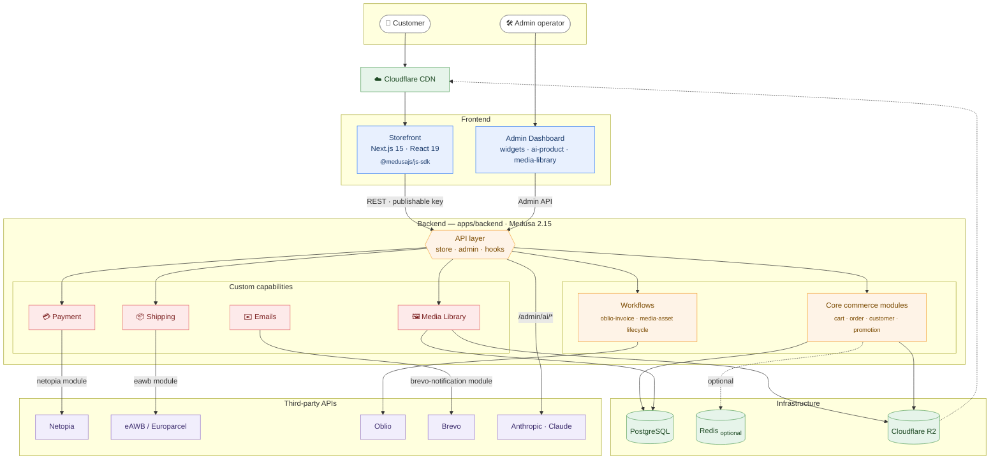
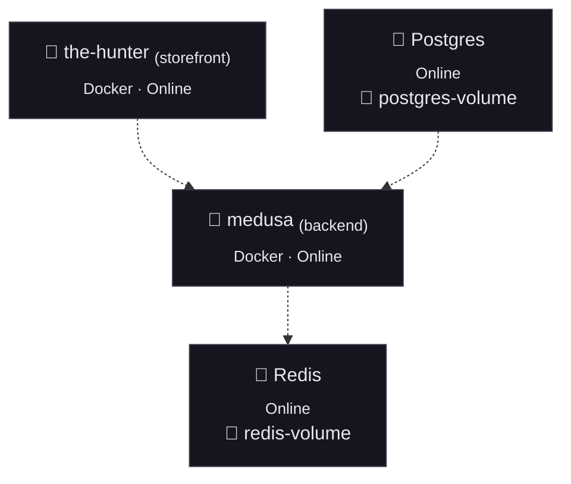

# The Hunter House — Commerce Platform

Commerce platform for **The Hunter House**, a Romanian luxury menswear D2C brand: a full e-commerce system on [Medusa 2.x](https://docs.medusajs.com) and Next.js 15, with local courier fulfillment (eAWB/Europarcel), local payments (Netopia), local e-invoicing (Oblio), an AI-assisted product creation workflow, and a custom media library. The platform runs in production on Railway (backend, storefront, Postgres, Redis), with Cloudflare R2 for file storage and Cloudflare for DNS, CDN and edge security.

A guiding constraint throughout: the admin should be able to customize almost anything — copy, categories, collections, tags, shipping rules, payment/notification providers — from the dashboard, without needing a code change or a redeploy for routine changes. Deploys are reserved for actual feature work, not day-to-day store operation.

This README covers architecture, infrastructure, the decisions behind them and their trade-offs, as well as how to run the project.

## Live Demo

|                      | URL                                         |
| -------------------- | ------------------------------------------- |
| Storefront (production) | [https://the-hunter-production.up.railway.app](https://the-hunter-production.up.railway.app) |
| Admin dashboard      | Available as a demo video on request — the admin runs against real store data and sits behind Cloudflare Access, so it isn't exposed publicly. |

## Contents

- [Live Demo](#live-demo)
- [Architecture](#architecture)
- [Infrastructure](#infrastructure)
- [Design Decisions & Trade-offs](#design-decisions--trade-offs)
- [Security](#security)
- [Known Limitations](#known-limitations)
- [Running Locally](#running-locally)
- [Roadmap](#roadmap)

## Architecture



A Turborepo monorepo. Backend and storefront share no runtime code and talk only over the Medusa REST/Admin API:

```
apps/
  backend/          Medusa 2.15 — commerce engine, admin dashboard, custom modules
  storefront/       Next.js 15 (App Router), React 19, Tailwind
  meridian-export/  standalone static Next.js export (launch page) for Cloudflare Pages
```

### Backend

Medusa's built-in commerce modules, extended with custom modules, workflows and subscribers running in the same DI container and event engine.

| Module               | Responsibility                                                      |
| -------------------- | ------------------------------------------------------------------- |
| `netopia`            | Netopia card payments — sessions, capture, signed IPN verification  |
| `eawb`               | eAWB/Europarcel courier — AWB labels, lockers, live shipping quotes |
| `brevo-notification` | Transactional email via Brevo                                       |
| `media-library`      | Reusable, admin-managed asset library with its own data model       |

**API routes**

- **Checkout:** `store/eawb/{lockers,shipping-prices,geocode}` (shared-secret guarded, since guest checkout has no session), `store/netopia/session-cart`, `hooks/netopia[/complete]`
- **Courier ops:** `admin/eawb/{fulfill,ship,cancel,label,order-status}` — create AWB → mark shipped (triggers the tracking email) → cancel at Europarcel
- **Invoicing:** `admin/oblio/[id]`, `admin/oblio-status`
- **AI:** `admin/ai/{generate-product,preview-token}` — see [below](#ai-product-generation)
- **Other:** media library, deleted products, translations revalidation, product preview, contact, newsletter, order invoice download, `robots.txt`

**Workflows** (step-level compensation): `create-oblio-invoice` (token → invoice → PDF → order metadata, as one unit) and the media-asset lifecycle.

**Subscribers:** order placed / shipped / canceled (cancelling an order also cancels its live AWB), Netopia cart completion, customer welcome and password reset, storefront revalidation on product changes.

**Admin UI:** widgets injected into the stock order and product views (eAWB, Oblio, preview) instead of a parallel UI, plus two custom pages: AI product creation and the media library.

### AI Product Generation

The platform's signature feature: an admin page that turns batches of product photos into ready-to-review products — copy, variants, prices, stock and per-variant images — using Claude (`claude-sonnet-4-6`).

**Flow:** CSV or manual rows → images downscaled to webp → one vision call per product, returning copy, SEO, category, tags, price, colors and image grouping as JSON → server-side validation against real store data (taxonomy must exist, image order must be a true permutation) → product built with variant matrix and SKUs → saved as a **draft**, never auto-published.

**Why:** one call per product because copy, colors and image grouping are too entangled to split; validation because model JSON is reliable in shape, not in substance; batches of 5 to respect rate limits; drafts because AI output is a first pass.

### Storefront

Next.js 15 / React 19, talking to the backend only through `@medusajs/js-sdk` and a publishable key. Tailwind, Radix and Framer Motion. Netopia is the sole payment provider.

## Infrastructure



- **Compute:** backend and storefront run as Docker containers on Railway in the same EU region, talking over Railway's private network — low latency, no egress cost. (The storefront moved from Netlify for exactly this reason.) The backend's multi-stage Dockerfile (Node 20-slim) builds the server and admin bundle; migrations run as a Railway pre-deploy step.
- **Data:** PostgreSQL; Redis backs cache, event bus, workflow engine, locking and sessions whenever `REDIS_URL` is set, with in-memory fallbacks for local dev.
- **Files:** Cloudflare R2 through `@medusajs/file-s3`, served via Cloudflare's CDN; local disk when no `S3_*` credentials are present.
- **Integrations:** Netopia, eAWB and R2 register only when their env vars exist, so the app always boots — manual fulfillment remains as a floor.
- **Backups:** a daily GitHub Actions job dumps the database to R2, deliberately independent of Railway.

## Design Decisions & Trade-offs

- **Run the store without deploys.** Products, taxonomy, media, courier and invoicing actions all live in the admin; deploys are for features only. The cost: config errors surface at runtime rather than at build time.
- **Env-gated providers.** Easy local and staging setup, at the price of implicit config ("missing var = different provider").
- **Workflows for multi-step side effects.** Oblio invoicing gets step-level rollback for free instead of hand-rolled try/catch.
- **Lightweight local dev, Redis everywhere else** — one config branch on `REDIS_URL`.
- **Cost-conscious stack.** A few small Railway services instead of managed cloud equivalents, and R2 instead of S3 for zero egress fees — sized for a small D2C brand's budget.

## Security

- **No secrets in git** — verified across full history; `.env.template` ships blank.
- **SSRF-hardened image fetching** in the AI route ([`safe-fetch.ts`](apps/backend/src/api/admin/ai/generate-product/safe-fetch.ts)): https only; private, loopback and metadata addresses rejected.
- **Netopia IPN** is open at the network level by design; integrity rests on a mandatory RSA signature check.
- **Rate limiting** (Redis-backed, per-IP, [`middlewares.ts`](apps/backend/src/api/middlewares.ts)) on contact, newsletter, customer auth and Netopia endpoints; the storefront shows a friendly message on `429`.
- **Edge protection** in Cloudflare: WAF rules, bot protection, global rate limiting, and the admin served only on its own domain behind Cloudflare Access (see [GOING-LIVE.md](GOING-LIVE.md)).

## Known Limitations

- **Preview links aren't signed** — the token is the product ID, so anyone who knows an unpublished product's ID can preview it.
- **The AI route's rate limiter** (20/hour per admin) is defined but currently disabled.
- **AI output is validated for shape, not correctness** — drafts aren't force-reviewed before publishing.
- **Multi-instance behavior on Redis** (cache, events, workflows, locking) is configured but untested at scale.

## Running Locally

**Prerequisites:** Node.js 20+, PostgreSQL 15+, npm 10+.

```bash
npm install
cp apps/backend/.env.template apps/backend/.env   # set DATABASE_URL
cd apps/backend
npm run medusa db:migrate
npm run medusa user -e admin@example.com -p supersecret
cd ../..
npm run dev   # backend :9000 (admin at /app), storefront :8000
```

The storefront needs `apps/storefront/.env.local` with `NEXT_PUBLIC_MEDUSA_PUBLISHABLE_KEY` (from Settings → Publishable API keys); see `check-env-variables.js` for the rest. Optional integrations (Netopia, eAWB, R2, Redis) switch on as soon as their env vars are added to `apps/backend/.env`.

## Roadmap

- **Re-enable CI** — the lint/test/build workflow is parked in `.github/workflows-disabled/`.
- **Tests** — only one unit spec today; Netopia webhooks and Oblio invoicing come first.
- **Explicit feature flags** instead of env-var presence.
- **Docker Compose** for a one-command local Postgres + Redis.
- **Multi-instance audit** of the Redis-backed subsystems.

## License

Proprietary — The Hunter House's codebase, published for portfolio purposes only. No permission is granted to reuse, copy or redistribute it; see [LICENSE](LICENSE).
